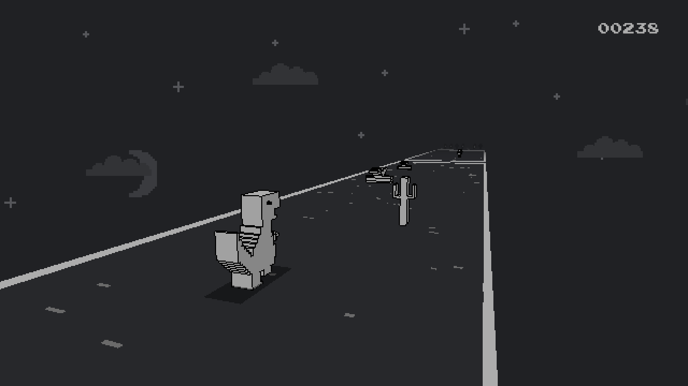
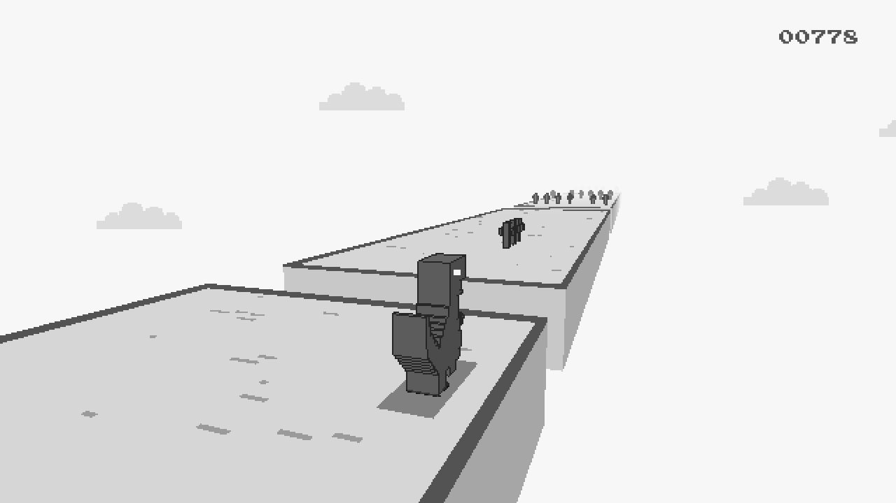
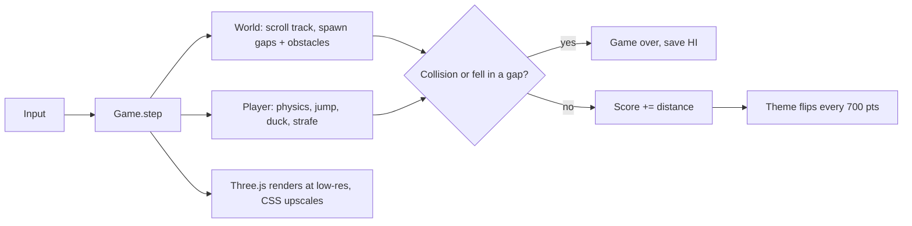

<div align="center">



### The Chrome dino, rebuilt as a third-person 3D platformer.

[](https://3d-dino.vercel.app)
&nbsp;


</div>

<table>
  <tr>
    <td align="center"><br><sub><b>Night</b> — the dark dino theme</sub></td>
    <td align="center"><br><sub><b>Day</b> — flips every 700 points</sub></td>
  </tr>
</table>

---

## ✨ Features

- 🦖 **Pixel-art dino in 3D** — every model is built from ASCII pixel art, extruded into voxels with a crisp outline
- 🎥 **Third-person camera** that follows the dino and leans into your strafing
- 🌗 **Day / night cycle** every 700 points, with moon, stars and clouds
- 🕳️ **Platformer mechanics** — gaps in the track, cacti, walls of cacti and pterodactyls (after 200 pts)
- 🧠 **Easy / Hard mode** — Hard has a rule engine that reacts to how you play (see below)
- ⚡ **Keeps accelerating** like the original, with variable-height jumps, duck and fast-fall
- 🏆 **Current score + HI score** (`HI 01415  00018`), saved in the browser; the score flashes every 100 points
- 🔊 **Retro beeps** generated with WebAudio — no audio files
- 📱 **Touch controls** appear automatically on phones

## 🎮 Controls

| Action | Keyboard | Touch |
| :-- | :-- | :-- |
| Jump (hold = higher) | `Space` · `↑` · `W` | ▲ or tap anywhere |
| Duck / fast-fall | `↓` · `S` | ▼ |
| Move sideways | `←` `→` · `A` `D` | ◀ ▶ |
| Start / restart | `Space` · `Enter` | tap |
| Switch Easy / Hard (between runs) | `M` | `MODE` button (top left) |


## 🧠 Game modes & the rule engine

**EASY** is the classic game: random obstacles, speed ramps up over time.
**HARD** adds a *director* ([`src/game/rules.ts`](src/game/rules.ts)) that watches how you play and shapes the track. Each high score is kept per mode.

| # | Rule | What it does |
| :-: | :-- | :-- |
| 1 | **No dodging** | Sidestep 2 obstacles in a row without a real jump/duck and the next row is an unbroken wall of cacti (or birds) you must go over or under. A callout warns you ~1 second ahead. |
| 2 | **Overdrive** | Speed is tied to score: 18 → 40 at **2000 points**, then +1 per 1000 (cap 46). |
| 3 | **Duck zone** | No real squat (hold ↓ for 0.4 s) for 250 points → a long low ceiling you must stay ducked under for **100 points** (**200 after 1500**). Squat fans still get one every 1200 points. |
| 4 | **Gauntlet** | Every 1000 points, 3 full walls in a row on a fixed jump rhythm. |
| 5 | **Breather** | After any hazard there are plain rows again, and a duck zone never shares the track with cacti or birds, so rules never stack into an impossible spot. |

Hard also uses wider gaps, tighter spacing and birds from 100 points. Every number is in the `HARD` object at the top of `rules.ts`.

<details>
<summary><b>🚀 Run it locally</b></summary>

```bash
git clone https://github.com/Pranesh0805-S/3D-Dino.git
cd 3D-Dino
npm install
npm run dev          # http://localhost:5173
```

Production build: `npm run build` → `dist/` · preview it with `npm run preview`.

</details>

<details>
<summary><b>☁️ Deploy to Vercel</b></summary>

**Dashboard:** vercel.com → *Add New → Project* → import this repo → *Deploy*. Vite is auto-detected.

**CLI:**
```bash
npm i -g vercel
vercel login
vercel --prod
```

</details>

<details>
<summary><b>🗂️ Project structure</b></summary>

```
3D-Dino/
├─ index.html            canvas + score / HI / game-over HUD
├─ vercel.json           Vite build + caching headers
├─ docs/                 banner and screenshots
└─ src/
   ├─ main.ts            entry point
   ├─ style.css          pixel-font HUD, touch buttons
   └─ game/
      ├─ config.ts       gravity, jump, speed ramp, scoring
      ├─ sprites.ts      dino / cactus / pterodactyl as ASCII pixel art
      ├─ voxel.ts        ASCII bitmap → voxel mesh + outline
      ├─ theme.ts        day / night palettes
      ├─ sky.ts          moon, stars, clouds
      ├─ player.ts       jump, duck, strafe, hitbox
      ├─ obstacles.ts    cacti, pterodactyls, collisions
      ├─ world.ts        endless track, gaps, spawning rows + duck zones
      ├─ rules.ts        Easy / Hard rule engine (the director)
      ├─ input.ts        keyboard + touch
      ├─ audio.ts        WebAudio sound effects
      └─ game.ts         state machine, camera, score / HI
```

</details>

<details>
<summary><b>🧠 How it works</b></summary>



The dino stays at the origin while the world scrolls toward the camera. Gap width and obstacle
spacing are computed from the current speed and jump air-time, so every layout is jumpable.

</details>

<details>
<summary><b>🎛️ Tweak the feel</b></summary>

Everything lives in [`src/game/config.ts`](src/game/config.ts):

| Setting | What it does |
| :-- | :-- |
| `gravity`, `jumpVel` | jump height and hang time |
| `speed0`, `speedMax`, `accel` | start speed, top speed, ramp-up |
| `scorePerUnit` | how fast the score climbs |
| `nightEvery` | points between day / night flips |
| `pteraMinScore` | when pterodactyls appear |

</details>

---

<div align="center">
<sub>Inspired by Chrome's offline dino game. Not affiliated with Google.</sub>
</div>
